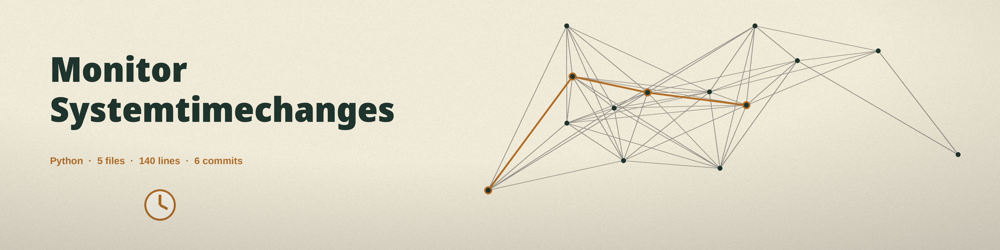

# monitor-systemtimechanges
Monitors changes to the system time, which can indicate attempts to evade detection. - Focused on System monitoring and alerts

The tool uses only the Python standard library, so there is nothing else to install. The first sample taken after startup is the baseline and is not tested. The threshold must be at least the interval: a run with a threshold below the interval is refused and exits 1 at startup.

## Install
`git clone https://github.com/ShadowStrikeHQ/monitor-systemtimechanges`

## Usage
`python3 main.py [params]`

## Parameters
- `-h`: Show help message and exit
- `-i`, `--interval`: Interval in seconds to check for time changes (default: 1). Must be a positive integer.
- `-t`, `--threshold`: Threshold in seconds to alert on time changes (default: 5). Must be a positive integer, and at least the interval.
- `-l`, `--log-file`: Path to the log file (default: system_time_monitor.log).

## License
Copyright (c) ShadowStrikeHQ
